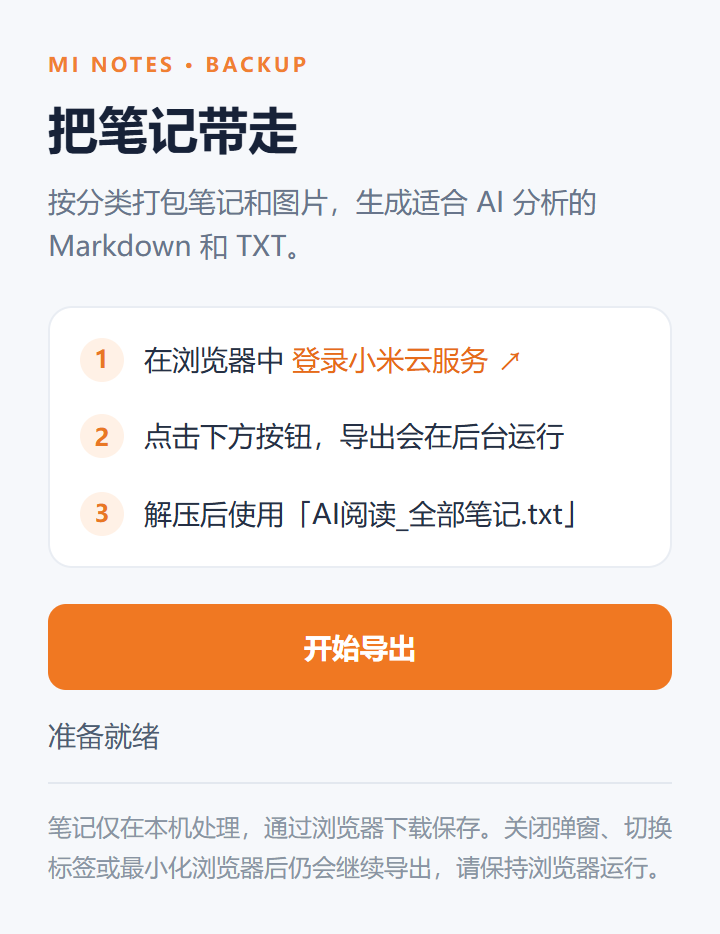
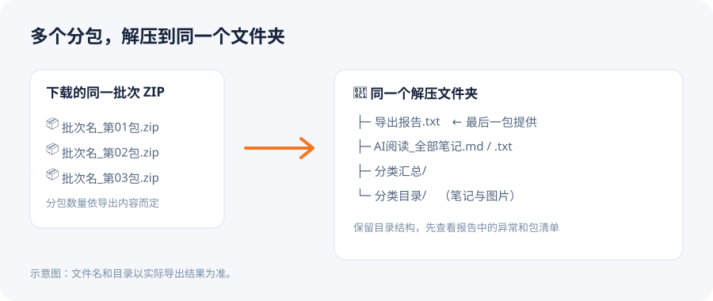

# 小米笔记 AI 导出插件

Chrome 和 Edge 扩展，可将小米云笔记、分类和图片导出为 ZIP，方便本地归档或交给 AI 分析。当前源码版本：**1.4.1**。

## 安装和使用

1. 下载 [1.4.1 插件安装包](releases/小米笔记导出插件_1.4.1.zip) 并解压，确认文件夹中有 `manifest.json`。也可以通过 **Code → Download ZIP** 下载源码并解压。
2. Chrome 打开 `chrome://extensions`，Edge 打开 `edge://extensions`。
3. 开启开发者模式，点击“加载已解压的扩展程序”，选择包含 `manifest.json` 的项目文件夹。
4. 登录 [小米云服务](https://i.mi.com/)，点击浏览器工具栏中的插件图标，再点击“开始导出”。
5. 弹窗可以关闭，也可以切换标签或最小化浏览器；重新打开弹窗可查看进度。导出期间请保持浏览器运行。
6. 下载完成后，将同一批次的所有 ZIP 解压到**同一个文件夹**，再查看最后一包中的“导出报告.txt”。

插件弹窗如下。登录小米云后点击“开始导出”，状态会显示在按钮下方：

内容较大时会自动下载多个独立 ZIP。如果某一包下载失败，界面会提示已完成的包；这一批文件不能视为完整导出。

## 导出文件

- `AI阅读_全部笔记.txt`：笔记文字与分类信息，适合交给 AI 分析。图片位置保留为文字提示。
- `AI阅读_全部笔记.md`：全量 Markdown，含指向包内图片的相对路径。
- `分类汇总/`：每个分类一份 Markdown，适合分主题分析；没有分类的笔记汇总在“未分类”。
- 每个分类目录：每篇笔记一个 Markdown 文件，图片放在该目录下的“图片”文件夹。标题为空时使用正文开头。
- `导出报告.txt`：列表状态、完整／部分成功／失败的笔记数量、图片与附件问题及分包清单；多包时位于最后一包。

全量文件和分类汇总过大时会编号分段。单篇笔记过大时也可能分成多个编号文件。不完整的笔记会在正文中标注，能够取得的摘要仍会保留，但不会被统计为完整正文。

图片是独立文件。大多数 AI 无法自动读取 Markdown 中引用的本地图片；需要识别图片时，请解压 ZIP，按 AI 平台要求把相关图片与文本一同上传。文件数量或上下文过大时，可按分类分批上传。

## 隐私与权限

插件不要求输入密码，不主动读取或导出 Cookie，也不会向第三方上传笔记。它通过当前浏览器中已登录的小米云账号读取笔记和图片，在本地处理并保存到下载目录。导出的 ZIP 不加密，请妥善保管，并在上传给 AI 前检查敏感内容。

- 小米域名访问权限：读取小米云笔记、分类和图片。
- `downloads`：保存导出 ZIP，并跟踪每个分包的下载状态。
- `offscreen`：在弹窗关闭后继续执行导出和打包。

每个 ZIP 不超过 128 MiB 或 10,000 个文件条目，单张图片超过 120 MiB 时会停止读取并在报告中标明；浏览器内存、磁盘空间和下载设置仍可能影响导出。私密笔记、回收站、待办和非图片附件不在本次导出范围；不支持的内容会尽量记录在报告中。小米接口可能变化，请在重要备份后与原笔记核对。

## 开发与测试

需要 Node.js 20 或更新版本、`playwright-core` 开发依赖，以及可用的 Chromium、Chrome 和 Edge。安装开发依赖后运行 `pnpm test`；测试使用隔离的浏览器配置和模拟小米接口，不访问真实账号。可通过 `MINOTE_TEST_BROWSER`、`MINOTE_TEST_CHROME`、`MINOTE_TEST_EDGE` 环境变量指定浏览器可执行文件。ZIP 独立解包测试使用 Windows PowerShell/.NET 和 `tar`。

## 许可证

[MIT](LICENSE)
